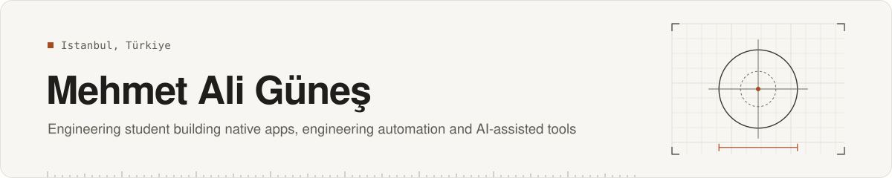

# Hi, I'm Mehmet Ali Güneş

I'm a mechatronics engineering student based in Istanbul. I build native iOS and macOS apps, engineering and building-automation tools, and AI-assisted developer tooling. I'm also interested in 3D pipelines and game prototypes.

I work **AI-assisted**: I define the problem, the architecture and the acceptance gates, and I verify the results. AI coding agents write much of the code under my direction, and an independent reviewer checks it. Every project in my portfolio says what is built, what is in progress, and what is only planned.

🎓 B.Sc. in Mechatronics Engineering, Bahçeşehir University · expected graduation May 2027 · Istanbul, Türkiye

## What I'm working on

- **AI agents & MCP:** local MCP servers, a policy proxy between an AI agent and CAD software, and multi-agent development workflows with approval gates.
- **Engineering & building automation:** I/O card distribution, BOM and engineering checks for building management systems (BMS); CAD automation.
- **Native apps:** SwiftUI and SwiftData on iOS and macOS, and React Native (Expo) / Next.js for mobile and web work.
- **3D pipelines:** Blender → USDZ → RealityKit, photogrammetry, and parametric mechanical models.
- **Game prototypes:** Godot and Unreal Engine.

## Featured projects

| Project | What it is | Status |
|---|---|---|
| [ClubsIQ](https://github.com/maliguness/engineering-software-portfolio/tree/main/projects/clubsiq) | Native iOS build calculator, library and advisor for a football game's Clubs mode (unofficial companion app) | In development · release prep |
| [Personal Center](https://github.com/maliguness/engineering-software-portfolio/tree/main/projects/personal-center) | Local-first macOS personal system with a local MCP server and an audited single write path | In development |
| [SolidWorks MCP Bridge](https://github.com/maliguness/engineering-software-portfolio/tree/main/projects/solidworks-mcp-bridge) | Policy-gated AI agent access to CAD software running in a Windows VM | Research prototype |
| [BMS Automation System](https://github.com/maliguness/engineering-software-portfolio/tree/main/projects/bms-automation) | I/O card distribution, BOM and engineering checks for building management systems | In development · paused |
| [Değer](https://github.com/maliguness/engineering-software-portfolio/tree/main/projects/deger) | Inflation-adjusted real return and purchasing-power app for Türkiye | In development |
| [Side Reconstruction](https://github.com/maliguness/engineering-software-portfolio/tree/main/projects/side-reconstruction) | Source-traceable 3D reconstruction of the ancient theatre of Side | Research prototype |

**→ [Full portfolio: engineering-software-portfolio](https://github.com/maliguness/engineering-software-portfolio)**. It covers all projects, grouped by category, with architecture diagrams and test evidence.

## Tools I work with

- **Used in my projects:** Swift, SwiftUI, SwiftData, TypeScript, React, Next.js, Expo / React Native, Model Context Protocol (MCP), GitHub Actions, Blender, RealityKit, Godot, Microsoft Excel
- **Supporting, with AI assistance:** C#, Python automation scripts, Unreal Engine Blueprints, n8n, Docker

## Links

- Portfolio: [engineering-software-portfolio](https://github.com/maliguness/engineering-software-portfolio)
- LinkedIn: [mehmet-ali-gunes](https://www.linkedin.com/in/mehmet-ali-gunes/)

Source code for most projects is private. The portfolio shows architecture, decisions and verified results instead.
